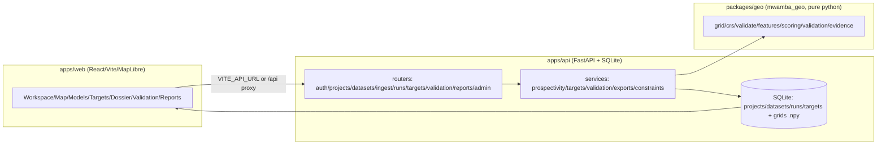

# MWAMBA — Malawi Mineral Exploration Intelligence Platform

> "Where should we look next for commodity X, why there, how confident are we, and what is missing?"

Mwamba (Challenge 1 entry) turns Malawi's scattered geological, geophysical,
geochemical, remote-sensing and historical exploration data into **ranked,
explainable, field-ready exploration targets** — with honest data labels and an
evidence gate that refuses to rank targets when the geology isn't there yet.

- **Live demo:** _pending — fill after Render deploy (frontend + `/api/health` in
  `docs/deploy-render.md`)_ · "Try the demo" one-click login, no password on screen.
- **Screenshots:** _pending — add `docs/screenshots/` after first live verify
  (Workspace, Map, Models gate, Targets, Dossier, Validation). No mockups._
- Pilot: **gold in the Chitipa belt** (commodity + AOI configurable: Au/C/REE/Nb/Ti/U).
- Every record labelled `VERIFIED / DERIVED / SYNTHETIC / MODEL OUTPUT / REVIEWED`
  (+ `UNVERIFIED` for incomplete citations, `EVIDENCE INCOMPLETE` for gated runs).
- Scores are **relative rankings 0..1**, never "probability of an economic deposit".
- Missing data is **not** negative evidence — a coverage layer is always computed.
- Deterministic: same inputs + seed ⇒ byte-identical grid (tested).

## Features

- Projects (commodity + Malawi-validated AOI: draw / 28-district picker / GeoJSON-KML upload).
- Ingest: GeoJSON/CSV (CRS auto-detect Malawi UTM36S 32736 vs Arc1950 20936),
  zipped shapefile, GeoPackage, KML, GeoTIFF/COG (DEM/geophysics/remote sensing),
  Sentinel-2 multiband → DERIVED iron-oxide + clay ratios, PDF reports → review queue.
- Cited-occurrence form: VERIFIED only with full citation (author + year + title).
- Engine: distance-to-structure decay, fault/lineament/drainage density,
  lithology scores, IDW geochem, DEM slope + DERIVED lineaments ("unverified
  structural proxy"), weighted overlay + fuzzy gamma, coverage everywhere.
- **Evidence gate**: commodity templates list required groups; runs missing groups
  are labelled `INSUFFICIENT EVIDENCE — not a targeting result` and generate zero
  ranked targets. Defaults target ~5–20 pilot targets (configurable).
- Targets: percentile → merge → min-area → rank; dossier with evidence breakdown,
  constraints, next steps, citations; review workflow → REVIEWED.
- Validation: success/prediction-rate curves, AUC, deterministic holdout,
  WofE/ML gated (needs ≥10 occurrences, honest message otherwise).
- Exports: GeoJSON/CSV/KML + dossier PDF + project summary; audit log; API keys.

## Data honesty labels

| Label | Meaning |
|---|---|
| `VERIFIED` | Sourced with provenance + licence (e.g. Copernicus DEM, USGS MRDS). |
| `DERIVED` | Computed from VERIFIED (slope, ratios, DEM lineaments + recipe). |
| `SYNTHETIC` | Fixtures in `data/fixtures` — pipeline tests/demo only, never geology. |
| `MODEL OUTPUT` | Scores/targets/exports from a run. |
| `REVIEWED` | Human sign-off with reviewer + date. |
| `UNVERIFIED` | Incomplete citation — stored, never validates a model silently. |
| `EVIDENCE INCOMPLETE` | Gated run/project — surface for inspection only, no ranked targets. |
| `MIXED` / `No data` | Project badge from its datasets (never VERIFIED when empty). |

Seeded on boot: **"Chitipa Gold — Synthetic demo"** (full loop: run → targets →
dossier → validation) and **"Chitipa Gold — Real data (evidence incomplete)"**
(Copernicus DEM + USGS sweep; gold gate honestly insufficient).

## Architecture



Runtime: SQLite (`storage/mwamba.db`), in-process BackgroundTasks (Celery path when
`REDIS_URL` set), grids as `.npy` served as sampled GeoJSON/PNG (no TiTiler needed).
`infra/docker-compose.yml` documents the full PostGIS/Redis/MinIO/TiTiler stack for
Docker hosts. Repository layer (`database.py`/`models.py`) is isolated for a PostGIS
cutover (see `docs/postgis-migration.md`).

## Local setup

Windows (PowerShell, one command each):

```powershell
# backend (repo root)
pip install -r requirements.txt; pip install ./packages/geo
uvicorn apps.api.app.main:app --port 8000
# frontend (new terminal)
Set-Location apps/web; npm ci; npm run dev
# App: http://localhost:5173   API docs: http://localhost:8000/docs   Health: http://localhost:8000/health
```

Linux/macOS:

```bash
pip install -r requirements.txt && pip install ./packages/geo
uvicorn apps.api.app.main:app --port 8000 &
cd apps/web && npm ci && npm run dev
```

Login: "Try the demo" when `DEMO_MODE=true`, else `admin@mwamba.local / Mwamba123!`
(seeded; passwords only from env in production — see `.env.example`).

Tests:

```powershell
pytest apps/api/tests packages/geo/tests -q
Set-Location apps/web; npm test; npm run build
npx playwright test   # needs browsers + both servers (see docs/smoke-test.md for manual path)
```

## Deployment (Render)

Blueprint `render.yaml`: `mwamba-api` (Python, `pip install -r requirements.txt &&
pip install ./packages/geo`, `uvicorn apps.api.app.main:app --host 0.0.0.0 --port $PORT`,
health `/api/health`) + `mwamba-web` (static, `npm ci && npm run build`,
publish `apps/web/dist`, SPA rewrite `/* → /index.html`, `VITE_API_URL` → API).
Full steps + verify checklist + env table: **`docs/deploy-render.md`**.

## Limitations

- Free-tier filesystem is ephemeral: DB seeded on startup; uploads/new runs reset
  (banner shown). See `docs/deploy-render.md`.
- In-process jobs: pilot AOIs at 100–200 m grid, 240 s timeout with clear error.
- SQLite now; Postgres via `DATABASE_URL` later (documented, not required).
- Real-data gold pilot is intentionally `EVIDENCE INCOMPLETE` (only DEM slope +
  non-gold USGS records) — the gate working as designed.
- OSM/Sentinel-2/protected-areas need manual import (queries saved in
  `docs/data-sources.md` + `docs/manual-data-download.md`).
- WofE training ships next; label gate + weighted/fuzzy active now.

## Roadmap

- [ ] Live URLs + screenshots in this README + `docs/deploy-render.md` log.
- [ ] PostGIS cutover (plan in `docs/postgis-migration.md`).
- [ ] WofE training when ≥10 occurrences; richer ML comparison.
- [ ] Sentinel-2 auto STAC fetch; OSM constraint sync.
- [ ] Playwright in CI (spec ships at `apps/web/tests/e2e/happy-path.spec.ts`).

## Licence

MIT for code (see `LICENSE`); data under its source licences
(Copernicus attribution, CC-BY 3.0 IGO, US public domain, ODbL — see
`docs/data-sources.md`). Synthetic fixtures are test/demo only.
