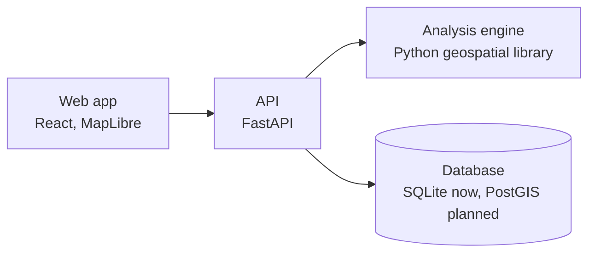

# Mwamba: Malawi Mineral Exploration Intelligence Platform

**Where should we look next, why there, how confident are we, and what is missing?**

Mwamba is a web platform that helps geologists, explorers, researchers and government teams turn Malawi's scattered geological data into ranked, explainable exploration targets.

It was built for **Challenge 1: From Geological Data to Mineral Discovery** of the Malawi UniPod / timbuktoo MineTech Pan-African Exploration Technology Pre-Incubation Programme.

**Status:** working prototype. Live demo coming soon.

## The problem

Malawi has a lot of geological knowledge: national geological mapping, airborne geophysical surveys, geochemical sampling, research studies and decades of exploration reports. But:

* The data sits in different formats, places and access levels, and much of it is locked in old scanned reports.
* Combining many layers to pick exploration targets takes specialist GIS and geoscience skills.
* Targeting is slow, costly and depends on a few specialists.
* Junior explorers, researchers and emerging Malawian explorers face the biggest barriers.

## What Mwamba does

Mwamba brings the data into one place, checks it, turns it into evidence, and ranks areas worth investigating. Every result explains itself.

1. **Bring data in.** Upload maps, points, rasters and reports. Mwamba checks coordinates, geometry, quality and source.
2. **Build evidence.** It turns raw data into evidence layers such as distance to faults, structural density, rock type favourability, geochemical anomalies, terrain and satellite alteration signals.
3. **Score the ground.** It combines the evidence with transparent methods (weighted overlay and fuzzy logic). Every weight and setting is visible and adjustable.
4. **Rank targets.** It outlines the most promising areas and ranks them.
5. **Explain each target.** Each target gets a dossier: why it scored high, which evidence supports it, what conflicts with it, what is missing, nearby constraints such as protected areas or settlements, and suggested next field steps.
6. **Review and export.** Geologists review targets and sign them off. Results export as GeoJSON, CSV, KML and PDF for field teams.

## Built to be honest

Exploration decisions cost real money, so Mwamba never hides what its results are based on.

**Every record carries a label:**

| Label | Meaning |
|---|---|
| VERIFIED | Real data with a known source and licence |
| DERIVED | Calculated from verified data, with the recipe recorded |
| SYNTHETIC | Made up test data, used only to test the software |
| MODEL OUTPUT | Scores and targets produced by an analysis run |
| REVIEWED | Checked and signed off by a person, with name and date |
| UNVERIFIED | A record with an incomplete citation |
| EVIDENCE INCOMPLETE | An analysis that lacks the evidence needed for real targeting |

**Other rules built into the platform:**

* **Evidence gate.** Each commodity has a list of required evidence types. For gold: structure, host rock, and alteration or geochemistry. If these are missing, Mwamba still shows the map for inspection but refuses to produce a ranked target list.
* **Scores are rankings, not chances.** A score compares areas with each other. It is never presented as the probability of finding a mine.
* **Missing data is not bad news.** An area with no data is not marked as unpromising. Data coverage is shown as a separate layer.
* **Repeatable.** The same inputs and settings always give exactly the same result.
* **Machine learning only when justified.** Statistical and machine learning methods unlock only when there are enough confirmed mineral occurrences to test them properly.

## Pilot: gold in the Chitipa belt

The platform ships with two demo projects:

* **Chitipa Gold, synthetic demo.** Uses made up test data to show the full workflow, from analysis to targets, dossiers and validation. Its results test the software, not geology.
* **Chitipa Gold, real data.** Uses real public data (Copernicus elevation model and USGS mineral records). It is honestly marked EVIDENCE INCOMPLETE, because the public data available so far is not enough to target gold. This shows the evidence gate working as designed.

The commodity and area are configurable: gold, graphite, rare earth elements, niobium, rutile and uranium are supported.

## Features

* Projects with a commodity and an area of interest (draw on the map, pick from 28 districts, or upload a boundary)
* Upload of GeoJSON, CSV, Shapefile, GeoPackage, KML and GeoTIFF
* Automatic handling of Malawi coordinate systems, including older Arc 1950 data
* Sentinel-2 satellite bands turned into iron oxide and clay alteration layers
* PDF report upload into a human review queue
* Cited occurrence entry: a record counts as verified only with a full citation
* Lineaments derived from the elevation model, clearly labelled as unverified structural hints
* Interactive map with layers, inspector and shareable views
* Ranked targets with full dossiers and a geologist review workflow
* Validation: success rate and prediction rate curves, AUC and held out occurrence tests
* Exports, audit log and API keys

## How it is built



* **Web app:** React, Vite, TypeScript, MapLibre GL, TanStack Query, Recharts
* **API:** Python, FastAPI, SQLite, token based sign in
* **Engine:** a standalone Python library for coordinates, validation, evidence layers, scoring and validation
* **Hosting:** prepared for Render (API as a Python web service, web app as a static site)
* **Cost:** runs on free or low cost services, with no paid map tiles, paid APIs or proprietary GIS software

## Run it locally

You need Python 3.11 and Node.js 18 or newer.

```bash
# API (from the repository root)
pip install -r requirements.txt
pip install ./packages/geo
uvicorn apps.api.app.main:app --port 8000
```

```bash
# Web app (in a second terminal)
cd apps/web
npm ci
npm run dev
```

Open http://localhost:5173. API documentation is at http://localhost:8000/docs.

Copy `.env.example` to `.env` and set your own admin email and password before first start. With `DEMO_MODE=true`, a "Try the demo" button signs you in without a password.

Run the tests:

```bash
pytest apps/api/tests packages/geo/tests -q
cd apps/web && npm test
```

## Data sources

| Source | Use | Status |
|---|---|---|
| Copernicus DEM (30 m) | Elevation, slope, lineaments | In use |
| USGS mineral resource records | Known occurrences | In use |
| Malawi district boundaries | Area of interest picker | In use |
| OpenStreetMap | Roads, settlements, water | Manual import |
| Sentinel-2 | Alteration signals | Manual import |
| Protected areas (WDPA) | Constraints | Manual import, not redistributed |
| Geological Survey Department / GEMMAP data | Geology, geochemistry, geophysics | To be requested |
| Published studies and survey bulletins | Cited occurrences | Manual entry |

Details and licences are in `docs/data-sources.md`.

## Current limitations

* No detailed geology, geochemistry or airborne geophysics loaded yet. These depend on access to national datasets.
* Not enough confirmed gold occurrences in the pilot area yet for real data validation.
* Commodity models are drafts and need review by experienced geologists.
* Uses SQLite for now, which suits pilot areas but not national scale.
* On free hosting, the demo resets uploads and new runs when the server restarts.
* This is a prototype and has not been security audited for production use.

## Roadmap

* Live demo and screenshots
* Access to Geological Survey Department and GEMMAP data
* Cited gold occurrences for the Chitipa pilot and a second pilot for rare earth elements in southern Malawi
* Geologist review of commodity models
* Move to PostGIS for national scale
* Weights of evidence and machine learning once enough occurrences exist
* Field checks of top targets with partners

## Licence

Code is released under the MIT licence (see `LICENSE`). Data keeps its original licence: Copernicus attribution, US public domain, ODbL for OpenStreetMap and others listed in `docs/data-sources.md`. Synthetic data is for testing and demonstration only.
